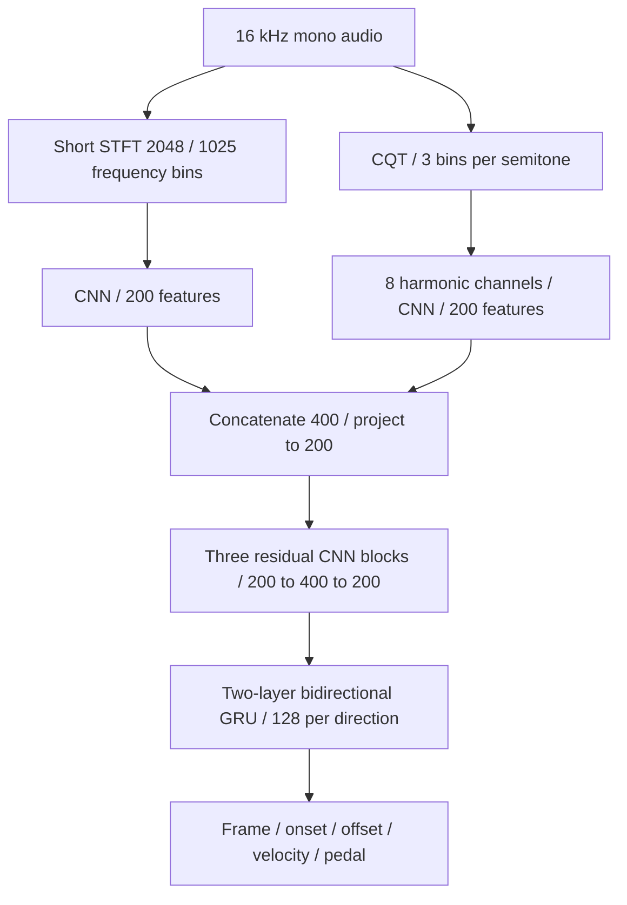
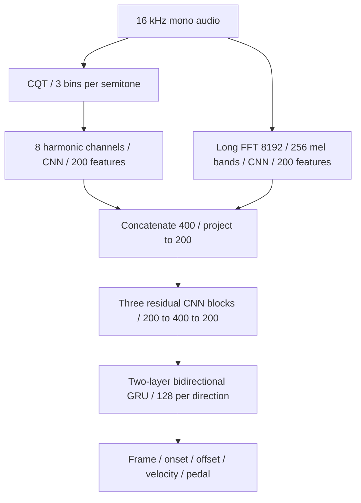
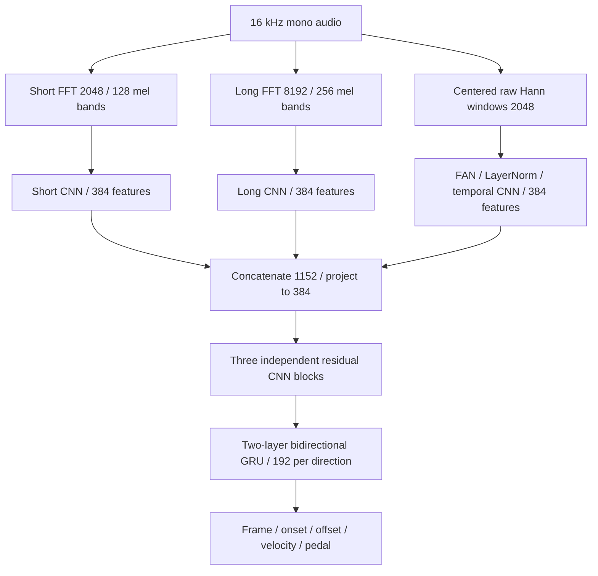

# Piano note and chord recognition with PyTorch

Identify piano notes and chords from WAV recordings, display the transcription on a piano grand staff, and play it with sampled piano sound.

The current model is **V10.1** (`onsets-stft-cqt-harmonic-recurrent`): short STFT → CNN and CQT → harmonic stack → CNN branches, fused into residual CNNs and a bidirectional GRU. It has **3,054,988 trainable parameters** and predicts note activity, starts, releases, velocity and sustain pedal. All 88 keys have equal pitch weights. **V10, V9 and V8.1 remain available**, with their preserved training/resume commands in the table below.

## Contents

- [Setup](#setup)
- [Data](#data)
- [Training](#training)
- [Desktop app and playback](#desktop-app-and-playback)
- [Web app and playback](#web-app-and-playback)
- [Command-line transcription](#command-line-transcription)
- [Evaluation](#evaluation)
- [V10.1 model](#v101-model)
- [V10 model](#v10-model)
- [V9 model and checkpoint selection](#v9-model-and-checkpoint-selection)
- [V8.1 model reference](#v81-model-reference)
- [Troubleshooting](#troubleshooting)
- [Older models](#older-models)
- [Project files and checks](#project-files-and-checks)

## Setup

Use Python 3.10 or newer with a compatible PyTorch/TorchAudio pair. Follow the [PyTorch installation instructions](https://pytorch.org/get-started/locally/) for your CPU or CUDA setup, then install the project requirements:

| Step | Command |
| --- | --- |
| 1 | `cd C:\jj\AI` |
| 2 | `python -m pip install -r requirements.txt` |

Commands below run from the project directory. `--device auto` uses CUDA when available and otherwise uses the CPU. Tkinter is included with the standard Windows Python installer; Linux installations may need their distribution's Tkinter package.

## Data

Training uses [MAESTRO v3.0.0](https://magenta.withgoogle.com/datasets/maestro): 1,276 solo-piano recordings with aligned WAV audio and MIDI, about 199 hours in total. Official train, validation and test splits separate compositions. The dataset uses [CC BY-NC-SA 4.0](https://creativecommons.org/licenses/by-nc-sa/4.0/).

### Current local inventory

Verified on **2026-10-08**, counting active recordings:

| Split | Complete recordings |
| --- | ---: |
| Training | 60 |
| Validation | 16 |
| Test | 4 |
| **Total** | **80** |

The latest replacement supplies **986 MB / 25 new training recordings** rich in notes **above G4 (MIDI 68–108)**. It retires **994 MB / 16 recordings** from active training. Note strikes above G4 increase from **50,657 to 106,811**; their share of all piano note strikes rises from **30.3% to 50.7%**. Active paired files occupy **3.872 GB**; retaining inactive backups brings all paired files to **5.865 GB**. All 50 new files passed size/CRC32 checks and all 25 new recordings loaded as training windows. The official CSV, validation/test files and all 34 existing checkpoints are unchanged. Details: [replacement verification](diagnostics/high-training-refresh-2026-10-08.json).

Training includes complete local pairs in the official training split, excluding names in `data/maestro/training-exclusions.json`, when `--max-files` is omitted. A running process keeps its startup file list; restart or resume it to use the replacement. Retired WAV/MIDI files stay at their original paths as inactive backups.

### Download data

On a new installation, fetch a small starting subset:

| Step | Command |
| --- | --- |
| 1 | `python -m piano_ml download --data data/maestro --train 8 --validation 2 --test 2` |

Add about **1 GB of training data**:

| Step | Command |
| --- | --- |
| 1 | `python -m piano_ml download --data data/maestro --additional-gb 1 --train-only` |

This skips existing complete files and adds only official training pairs. The budget measures extracted audio/MIDI bytes; compressed transfer is smaller, and the final size may be slightly below the budget. Add `--dry-run` to inspect the plan first. Running the command again adds another batch. Its manifest is `data/maestro/additional-download-plan.json`.

For recordings ranked by rare bass-note coverage:

| Step | Command |
| --- | --- |
| 1 | `python -m piano_ml download --data data/maestro --bass-gb 1` |

This also uses only training pairs. It caches a separate, verified 56 MB MIDI index in `data/maestro/.bass-index/` and saves `bass-download-plan.json`. `--dry-run` prepares the index and plan without downloading audio.

Replace about **1 GB** with new recordings rich in notes **strictly above G4 (MIDI 68–108 inclusive)**:

| Step | Command |
| --- | --- |
| 1 | `python -m piano_ml download --data data/maestro --replace-high-gb 1` |

Add `--dry-run` to preview the selection. Each candidate must have at least 50% of its piano note strikes above G4; ranking favors scarce pitches in that range per byte. The command retires active recordings with lower high-note fractions, downloads genuinely new official training pairs, verifies their sizes and CRC32 checksums in staging, and then switches the active list. All 88 keys still have equal training loss weights and ordinary random window sampling. This changes the data distribution; it does not change V8.1's model or minimum validation AvgF selection.

The plan is `data/maestro/high-refresh-plan.json`; individual runs are retained in `.high-refresh-manifests/`. Downloads use up to eight independent archive readers. If interrupted, rerun the same command: a matching plan reuses complete staged files after checking their sizes and CRC32 again; incomplete files restart. Retired files stay as inactive backups, so the replacement needs space for the new files. Validation and test data stay unchanged. Restart or resume training to load the updated active set; omit `--max-files` to include every active recording.

The earlier **MIDI 30–68** replacement remains available:

| Step | Command |
| --- | --- |
| 1 | `python -m piano_ml download --data data/maestro --replace-middle-gb 1` |

Add `--dry-run` to preview the selection. Candidates must have at least 75% of piano notes within the focus range; ranking favors scarce focus pitches per byte. The command retires training recordings with lower focus fractions, verifies all new WAV/MIDI sizes and CRC32 checksums in staging, and then switches the active list. It uses only the official training split. The official CSV and validation/test recordings stay unchanged.

Its manifest is `data/maestro/middle-refresh-plan.json`; individual runs are retained in `.middle-refresh-manifests/`. To restore a retired pair from either replacement mode, remove its `audio_filename` from `excluded_audio_filenames` in `training-exclusions.json` and restart training. Repeating a replacement command replaces another batch.

To expand validation to a **target total** of 24 recordings:

| Step | Command |
| --- | --- |
| 1 | `python -m piano_ml download --data data/maestro --validation-total 24 --validation-budget-gb 1 --seed 42` |

Changing validation recordings starts a new best-score comparison on resume. Without `--train-only`, `--additional-gb` allocates approximately 80% of added bytes to training, 10% to validation and 10% to test.

Downloads use HTTP range requests to fetch selected entries from official ZIP archives. To use the full dataset instead, extract the official archive so `data/maestro/maestro-v3.0.0.csv` and its year directories sit alongside each other. The full ZIP is about 101 GB compressed.

## Training

### Training commands

Copy one complete command from the table. Run it from the project folder shown in Setup. **V10.1 is the default for fresh auto training**; explicit architecture flags preserve the earlier versions. Start commands use random weights; resume commands require the corresponding existing latest checkpoint.

| Version | Action | Command |
| --- | --- | --- |
| V10.1 | Start | `python -m piano_ml train --data data/maestro --architecture onsets-stft-cqt-harmonic-recurrent --output checkpoints/piano-v10.1.pt --epochs 100 --lr 0.0003 --threshold-lr 0.003 --selection-metric avgf_loss --lr-patience 6 --windows-per-file 32 --batch-size 4 --augment --device auto` |
| V10.1 | Resume | `python -m piano_ml train --data data/maestro --resume checkpoints/piano-v10.1.last.pt --output checkpoints/piano-v10.1.pt --epochs 50 --windows-per-file 32 --batch-size 4 --device auto` |
| V10 | Start | `python -m piano_ml train --data data/maestro --architecture onsets-cqt-harmonic-recurrent --output checkpoints/piano-v10.pt --epochs 100 --lr 0.0003 --threshold-lr 0.003 --selection-metric avgf_loss --lr-patience 6 --windows-per-file 32 --batch-size 4 --augment --device auto` |
| V10 | Resume | `python -m piano_ml train --data data/maestro --resume checkpoints/piano-v10.last.pt --output checkpoints/piano-v10.pt --epochs 50 --windows-per-file 32 --batch-size 4 --device auto` |
| V9 | Start | `python -m piano_ml train --data data/maestro --architecture onsets-triple-residual-recurrent --output checkpoints/piano-v9.pt --epochs 100 --lr 0.0003 --threshold-lr 0.003 --selection-metric avgf_loss --lr-patience 6 --windows-per-file 32 --batch-size 4 --augment --device auto` |
| V9 | Resume | `python -m piano_ml train --data data/maestro --resume checkpoints/piano-v9.last.pt --output checkpoints/piano-v9.pt --epochs 50 --windows-per-file 32 --batch-size 4 --device auto` |
| V8.1 | Start | `python -m piano_ml train --data data/maestro --architecture onsets-fourier-recurrent --output checkpoints/piano-v8.1.pt --epochs 100 --lr 0.0003 --threshold-lr 0.003 --selection-metric avgf_loss --lr-patience 6 --windows-per-file 32 --batch-size 4 --augment --device auto` |
| V8.1 | Resume | `python -m piano_ml train --data data/maestro --resume checkpoints/piano-v8.1.last.pt --output checkpoints/piano-v8.1.pt --epochs 50 --windows-per-file 32 --batch-size 4 --device auto` |
| V7 | Start | `python -m piano_ml train --data data/maestro --architecture onsets-multires-balanced --output checkpoints/piano-v7.pt --epochs 100 --lr 0.0003 --windows-per-file 32 --batch-size 4 --device auto` |
| V7 | Resume | `python -m piano_ml train --data data/maestro --resume checkpoints/piano-v7.last.pt --output checkpoints/piano-v7.pt --epochs 50 --windows-per-file 32 --batch-size 4 --device auto` |
| V6 | Start | `python -m piano_ml train --data data/maestro --architecture onsets-multires-global --output checkpoints/piano-v6.pt --epochs 100 --lr 0.0003 --windows-per-file 32 --batch-size 4 --device auto` |
| V6 | Resume | `python -m piano_ml train --data data/maestro --resume checkpoints/piano-v6.last.pt --output checkpoints/piano-v6.pt --epochs 50 --windows-per-file 32 --batch-size 4 --device auto` |
| V5 | Start | `python -m piano_ml train --data data/maestro --architecture onsets-recurrent-global --output checkpoints/piano-v5.pt --epochs 100 --lr 0.0003 --windows-per-file 32 --batch-size 4 --device auto` |
| V5 | Resume | `python -m piano_ml train --data data/maestro --resume checkpoints/piano-v5.last.pt --output checkpoints/piano-v5.pt --epochs 50 --windows-per-file 32 --batch-size 4 --device auto` |
| V4 | Start | `python -m piano_ml train --data data/maestro --architecture onsets-recurrent --output checkpoints/piano-v4.pt --epochs 100 --lr 0.0003 --windows-per-file 32 --batch-size 4 --device auto` |
| V4 | Resume | `python -m piano_ml train --data data/maestro --resume checkpoints/piano-v4.last.pt --output checkpoints/piano-v4.pt --epochs 50 --windows-per-file 32 --batch-size 4 --device auto` |
| V3 | Start | `python -m piano_ml train --data data/maestro --architecture onsets-calibrated --output checkpoints/piano-v3.pt --epochs 100 --lr 0.0003 --windows-per-file 32 --batch-size 4 --device auto` |
| V3 | Resume | `python -m piano_ml train --data data/maestro --resume checkpoints/piano-v3.last.pt --output checkpoints/piano-v3.pt --epochs 50 --windows-per-file 32 --batch-size 4 --device auto` |
| V2 | Start | `python -m piano_ml train --data data/maestro --architecture onsets --output checkpoints/piano-v2.pt --epochs 100 --lr 0.0003 --windows-per-file 32 --batch-size 4 --device auto` |
| V2 | Resume | `python -m piano_ml train --data data/maestro --resume checkpoints/piano-v2.last.pt --output checkpoints/piano-v2.pt --epochs 50 --windows-per-file 32 --batch-size 4 --device auto` |
| Frame | Start | `python -m piano_ml train --data data/maestro --architecture frame --output checkpoints/piano.pt --epochs 100 --lr 0.0003 --windows-per-file 32 --batch-size 4 --device auto` |
| Frame | Resume | `python -m piano_ml train --data data/maestro --resume checkpoints/piano.last.pt --output checkpoints/piano.pt --epochs 50 --windows-per-file 32 --batch-size 4 --device auto` |
| V8 to V8.1 | Continue with fresh optimizer | `python -m piano_ml train --data data/maestro --resume checkpoints/piano-v8.last.pt --output checkpoints/piano-v8.1.pt --middle-sampling 0 --bass-sampling 0 --treble-sampling 0 --middle-loss-weight 1 --edge-loss-weight 1 --reset-optimizer --lr 0.0001 --threshold-lr 0.001 --epochs 50 --windows-per-file 32 --batch-size 4 --augment --device auto` |

### Model settings

- **V10.1:** short 2048-sample STFT → CNN, plus CQT → harmonic stack → CNN; 3,054,988 parameters. Feature width is 200, GRU hidden size is 128 per direction, with two GRU layers and three residual CNN blocks. Use --short-fft to change the short window for a fresh run. The long FFT branch has been replaced by CQT.
- **V10:** harmonic CQT → CNN plus long FFT → CNN; unchanged 3,035,788 parameters. Its explicit start/resume commands remain above, and --long-fft still applies.
- **V9:** short FFT, long FFT and raw FAN branches; unchanged 10,168,060 parameters.
- **V8.1:** two FFT branches, FAN fusion and temporal Fourier mixing; unchanged 10,012,924 parameters. V8 checkpoints remain compatible and continue as V8.1.
- **Earlier versions:** the table retains their architecture choices and versioned outputs. The current trainer applies its ordinary random sampling and equal pitch weights; historical experiment settings remain documented in docs/model-versions.md.

V10.1 uses separate files named piano-v10.1.pt, piano-v10.1.last.pt and piano-v10.1.history.jsonl. Its model_version is 10.1 and checkpoint format_version is 12. V10 retains model_version 10 / format_version 11; V9 retains 9 / 10; V8.1 retains 8.1 / 9.

### Resume, initialization and training length

Use the latest completed .last.pt checkpoint. --epochs 50 requests **50 additional epochs**. Resume restores the checkpoint's architecture, weights, learned thresholds, optimizer, scheduler, epoch and random state. **Early stopping is disabled for every version.** Older --patience options remain accepted and ignored.

V10.1 starts with random recognizer weights and three random global thresholds in 0.35–0.65. A random seed is printed and saved; add --seed 42 for repeatable initialization. It needs fresh training or a compatible V10.1 checkpoint via --init-from. V10, V9 and V8.1 weights cannot initialize its changed structure. Other versions retain their own initialization rules.

With 60 active training recordings and --windows-per-file 32, an epoch contains **1,920 training windows / 480 batches** at batch size 4 and **256 fixed validation windows**. Windows are four seconds long. Training uses ordinary random windows with the augmentation settings from its command; validation uses deterministic ordinary windows.

All 88 keys have pitch weight 1 by default; bass, middle and treble sampling default to 0. Positive-note/event weights still distinguish active and inactive targets equally across pitches. Optional pitch-focus flags remain available for explicit experiments. Checkpoints from older trainers clear saved pitch emphasis when migrated; new checkpoints record training_config.pitch_emphasis_version=2 and restore their recorded settings.

Keep the same --seconds and --windows-per-file to preserve the validation comparison. Ctrl+C discards an incomplete epoch and leaves the latest completed checkpoint available. Supply --lr or --threshold-lr to override a restored learning rate. --reset-optimizer starts fresh optimizer/scheduler state.

The V8-to-V8.1 continuation row preserves the earlier command, writes under the V8.1 filenames, and evaluates the starting model with validation AvgF loss before comparing improvements. A change of selection criterion resets its comparison state; previous decoded scores are not compared numerically to a loss.

### Saved files and training length

| File | Use |
| --- | --- |
| `checkpoints/piano-v10.1.pt` | Best V10.1 validation AvgF loss; select it in the app after training. |
| `checkpoints/piano-v10.1.last.pt` | Latest completed V10.1 epoch; resume from this file. |
| `checkpoints/piano-v10.1.history.jsonl` | V10.1 losses, scores, thresholds and timing. |
| `checkpoints/piano-v10.pt` | Best validation AvgF loss; select V10 in the app after training. |
| `checkpoints/piano-v10.last.pt` | Latest completed V10 epoch; resume from this file. |
| `checkpoints/piano-v10.history.jsonl` | V10 losses, scores, thresholds, learning rates and timing. |
| `checkpoints/piano-v9.pt` | Best validation AvgF loss; select V9 in the app after training. |
| `checkpoints/piano-v9.last.pt` | Latest completed V9 epoch; resume from this file. |
| `checkpoints/piano-v9.history.jsonl` | V9 losses, scores, thresholds, learning rates and timing. |
| `checkpoints/piano-v8.1.pt` | Best validation score; select this model in the app. |
| `checkpoints/piano-v8.1.last.pt` | Latest completed epoch; resume training from this file. |
| `checkpoints/piano-v8.1.history.jsonl` | Per-epoch scores, thresholds, learning rates and timing. |

For V10.1, V10, V9 and V8.1, **`avgf_loss`** controls best-model selection and learning rate scheduling. **Lower is better**: replace best when `val_avgf_loss < best_loss - 1e-6`. The scheduler runs in minimum mode. `best_score` stores the minimum loss, and `selection_mode="min"` records its direction. Training runs all requested epochs even when validation stops improving. The `stale_epochs` count remains a diagnostic; learning rate reduction uses `--lr-patience`.

Validation AvgF loss uses the same smooth mean(F0,F1,F2,F3) threshold objective as training, with equal key weights, inactive-key false-activity penalties and threshold-prior regularization. Soft decisions are `sigmoid((probability - threshold) / temperature)`. Counts from frame, onset and offset targets are summed across **all validation frames before computing the loss**, so a smaller final batch or different batch size does not alter weighting. This reuses the existing validation predictions and adds no model forward passes.

The console prints `val_avgf_loss`; checkpoints/history save it as `validation.avgf_loss`, alongside `avgf_data_loss` and `avgf_prior_loss`. Training `threshold_loss` remains the raw per-batch threshold objective. Decoded pitch F0123, note F1 and onset F1 remain recognition diagnostics. Smooth-loss improvements do not guarantee higher decoded note scores. Use `--selection-metric note_macro_f0123` for an explicit comparison using the previous selection method.

Changing the validation files, window settings or selection metric starts a new comparison. Adding training recordings alone preserves comparison with the previous best.

### Comparing training and validation loss

Compare **`train_frame_bce` with `val_frame_bce`**. Both use unweighted binary cross-entropy over frame/key elements, with no positive-note or pitch-range weights. Each epoch averages over all elements, so a smaller final batch contributes proportionally.

Example output (illustrative numbers):

```text
epoch=101 train_total_loss=0.4875 train_frame_bce=0.0912 val_frame_bce=0.0798 ...
  train_loss_components: frame=0.1800 onset=0.0550 offset=0.0400 release=0.0110 velocity=0.0030 pedal=0.0017 threshold=0.1968
```

| Field | Meaning |
| --- | --- |
| `train_total_loss` | Console name for the complete optimization objective; saved as the existing `train_loss` history field. |
| `train_frame_bce` | Unweighted frame loss on the training predictions already computed during optimization. |
| `val_frame_bce` | Unweighted frame loss on validation; saved as `validation.frame_bce`. |
| `train_loss_components` | Seven contributions after applying their weights, averaged per batch. Their sum equals `train_loss`, within floating-point rounding. |
| `threshold_loss` | Existing raw threshold objective before applying `threshold_loss_weight`; the component report includes that multiplier. It is zero when threshold learning is disabled. |
| `validation.loss` | Existing unweighted frame loss averaged equally over batches, retained for compatibility. It can differ from `frame_bce` when batch sizes differ. |

Completed-epoch best/latest checkpoints also save `training_metrics` with `total_loss`, `frame_bce` and `loss_components`. Frame-only models report zero for unsupported components. New fields appear after restarting/resuming with this trainer; existing history lines remain unchanged, and older checkpoints can still resume.

Training still uses augmentation, dropout and ordinary random sampling; validation uses evaluation mode and deterministic ordinary windows. These conditions can create a gap even with the same frame-loss formula. Reporting reuses existing predictions and adds no model forward passes. Validation **AvgF loss** selects the best V10.1/V10/V9/V8.1 checkpoint; use decoded pitch F0123 and note scores to assess recognition quality.

## Desktop app and playback

| Step | Command |
| --- | --- |
| 1 | `python app.py` |

1. Choose a checkpoint in **Model**. Use **Refresh** to discover saved models or **Browse model…** to open another checkpoint. The app prefers `piano-v10.1.pt` when it exists, then `piano-v10.pt`, `piano-v9.pt`, `piano-v8.1.pt` and `piano-v8.pt`. Its threshold summary displays the loaded model version. V10.1 supports all three overlap methods, score display, Basic Pitch comparison and piano playback after training.
2. Select **Choose WAV…** and open an uncompressed 16-bit PCM piano recording.
3. Select **Analyze**. Expand **Analysis settings** to change thresholds or overlap. The app starts with **Weighted average**, 2 seconds of overlap and the model's saved thresholds. Choose **Auto**, **CPU** or **CUDA** beside Analyze.
4. Open **Staff** for a grand staff with five treble lines and five bass lines. **Staff zoom** adjusts the notation size from 75% to 200% (starting at 125%). Scroll the main content with the mouse wheel or right-hand scrollbar to view the larger score. **Previous** and **Next** change pages; **Notation tempo (BPM)** and **Update staff** adjust the approximate notation.
5. Choose **Your model** in the fixed **LISTEN** bar at the bottom and press the green **Play** button. It changes to **Pause** during playback; press Play again to continue. Drag the progress slider to seek. Playback controls remain visible while the main content scrolls. Saved JSON results can also be played without a checkpoint or original recording.

| Control or view | Purpose |
| --- | --- |
| **Analysis overlap (s)** | Choose 0–4 seconds of shared audio between neighbouring analysis inputs; starts at 2 seconds. Analyze again to apply a change. |
| **Overlap method** | Choose **Weighted average**, **50/50 average** or **Keep center**. Analyze again to apply a change. |
| **Compare with Basic Pitch** | Analyze the same WAV with Spotify's bundled model, independently of your checkpoint. |
| **Your model / Basic Pitch result cards** | Select which transcription appears in Staff, Timeline, Notes and Chords. Show event counts and analysis time. |
| **LISTEN source selector** | Choose **Your model**, **Basic Pitch** or **Original recording**. Switching sources preserves playback position and continues if playing. |
| **Play / Pause** | Play the selected source or pause at the current position. Detected notes use the same piano sound for both models. |
| **Original** | Start the input WAV at the current position. |
| **Progress slider** | Drag to seek; playback resumes on release if it was playing. Clicking the score, timeline or an event also seeks. |
| **Stop** | Return to the start or cancel result-audio preparation. |
| **Volume** | Adjust result and original playback from 0% (mute) to 100%, including while audio is playing. |
| **Gain** | Boost quiet result or original playback by 0 to +24 dB, including while audio is playing. |
| **Timeline** | Inspect the waveform, piano roll and chord spans. |
| **Notes / Chords** | Inspect detected events and timestamps. |
| **Export result WAV…** | Save the transcription as stereo, 44.1 kHz, 16-bit PCM audio. |
| **Export JSON…** | Save detected events. |
| **Save view…** | Export the current Staff or Timeline view as a PNG. |

Staff notation approximates rhythm in 4/4; playback follows the detected event times. The playback cursor follows the sound and advances staff pages automatically. Result playback works without the original recording.

### Playback performance

Playback moves only the cursor on the visible chart, reusing its static image. Hidden charts skip cursor redraws and catch up when opened. Active notes/chords use a time index, and staff pages batch noteheads, stems and ledger lines for faster drawing. Cursor updates run at up to 30 frames per second during playback; dragging the progress slider combines rapid preview updates and seeks to the final position on release. Zoom, resize and tempo changes refresh the chart normally.

A local synthetic test with **3,000 notes and 300 chord spans** reduced median cursor-update time from **119–124 ms to about 5 ms** on Staff/Timeline. A score-page transition decreased from **463 ms to 160 ms**. These are display timings on this computer, excluding model analysis and first-play audio rendering: [before](diagnostics/playback-ui-before.json) / [after](diagnostics/playback-ui-after.json). Notes, event timing and synthesized audio are unchanged.

The **Volume** slider sits below the progress slider and shows the current percentage. It starts at 50% and can be increased to 100% or lowered to 0% (mute). It controls app playback. Exported WAV files retain their rendered volume.

The **Gain** slider beside Volume starts at **0 dB**. Try **+6 dB** for about twice the signal amplitude, or **+12 dB** for about four times. Volume and gain apply together; 0% volume still mutes at any gain. Loud peaks are limited to the 16-bit range; reduce gain if they sound distorted. Gain affects playback, and exported WAVs retain their rendered volume.

To compare your checkpoints, select another checkpoint and analyze the same audio again. This replaces the **Your model** result and keeps Basic Pitch for that recording. Expand **Analysis settings** and uncheck **Use model thresholds** to edit **Frame**, **Onset** and **Offset** individually; analyze again to apply the changes.

### Desktop Basic Pitch comparison

1. Choose a WAV and analyze your checkpoint.
2. Click **Compare with Basic Pitch**. A checkpoint is optional for this step.
3. Select either result card to inspect its staff or timeline. Use the **LISTEN** selector to compare the two piano renderings with the original. Each result has its own cached audio; the first playback renders it.
4. Export the selected result with **Export JSON…**, **Save view…** or **Export result WAV…**.

Both results stay available for the same recording. Choosing another WAV or opening a saved JSON clears the comparison. Basic Pitch keeps its own defaults (onset **0.50**, frame **0.30**, minimum note length about **128 ms**); it does not alter your model's threshold or overlap controls. It estimates note durations and plays discrete piano pitches, without pitch bends or predicted sustain pedal. Event counts are not accuracy scores.

Basic Pitch runs offline on CPU using the official ONNX model and an adapted version of Spotify's polyphonic note decoder. Its approximately **225 KiB** model is bundled in `assets/basic-pitch/`; its Apache 2.0 license and source attribution are beside it. Source: [Spotify Basic Pitch](https://github.com/spotify/basic-pitch). ONNX Runtime is included in `requirements.txt`:

| Step | Command |
| --- | --- |
| 1 | `python -m pip install -r requirements.txt` |

If the bundled model is missing, restore the pinned, checksum-verified download:

| Step | Command |
| --- | --- |
| 1 | `python diagnostics/download_basic_pitch.py` |

### Analysis overlap

The app processes consecutive **4-second sections**. **Analysis overlap (s)** controls extra audio context: half the selected overlap is added on each side. The default is **2 seconds** of overlap (**1 second per side**), increased from the previous 1-second overlap.

| Section | Input with 2-second overlap | Input with 4-second overlap |
| --- | --- | --- |
| 4–8 seconds | 3–9 seconds | 2–10 seconds |
| 8–12 seconds | 7–13 seconds | 6–14 seconds |

**Keep center** retains only each section's central predictions. **Weighted average** (the app default) combines probabilities before thresholds and note decoding, using the same linear weights for frame, onset, offset, velocity and pedal. Across an overlap it gradually favours the later calculation, whose predictions are farther from its input's left edge. At an 8-second boundary with a 2-second overlap:

| Time | Earlier calculation | Later calculation |
| --- | ---: | ---: |
| 7 seconds | 100% | 0% |
| 7.5 seconds | 75% | 25% |
| 8 seconds | 50% | 50% |
| 8.5 seconds | 25% | 75% |
| 9 seconds | 0% | 100% |

**50/50 average** gives both calculations equal weight at every shared timestamp: `(earlier_probability + later_probability) / 2`. It averages probabilities after sigmoid for all five outputs, then decodes notes once. For the example above, every frame from 7 seconds up to (excluding) 9 seconds uses 50/50; at 9 seconds only the later calculation supplies the prediction. Unlike the linear blend, the equal average can change abruptly at the overlap's edges.

Outside overlaps, one calculation supplies the prediction. With zero overlap, all three methods behave identically. Inputs are clipped at the recording's start and padded with silence past its end; predictions past the actual recording and duplicate FFT endpoint frames are excluded. The completed timeline is decoded once.

Blending adds no model forward passes. It may smooth section boundaries, but can weaken onset or offset peaks; recognition improvement is not guaranteed. More overlap increases analysis time and memory use. FFT sizes, the 20 ms prediction interval and training settings stay the same. Compare all three methods on the same recording with the same overlap and thresholds.

Exported JSON records `inference_config` with `chunk_seconds`, `context_seconds` (each side), `overlap_seconds` (shared between neighbours) and `overlap_blend` (`weighted`, `equal` or `crop`). Loading a result restores its selections; older files select **Keep center**. The Python inference APIs accept `overlap_blend="weighted"` or `overlap_blend="equal"`; their default and command-line transcription retain `crop`, with the existing overlap (1 second for multitask models, 0 for legacy frame-only models).

A spot check on the current V8 checkpoint used the first 60 seconds of three validation recordings, with identical saved thresholds and 2-second overlap:

| Measurement | Keep center | Weighted average | 50/50 average |
| --- | ---: | ---: | ---: |
| Pitch F0123 | 0.4267 | 0.4307 | 0.4356 |
| Onset F1 | 0.8067 | 0.8111 | 0.8129 |
| Note F1 with offsets | 0.5141 | 0.5184 | 0.5227 |
| Total analysis time, CUDA | 2.70 s | 2.53 s | 2.55 s |

50/50 scored highest on these three excerpts. They are a small comparison, and a single timing run does not establish a speed improvement. The checkpoint was unchanged. The [comparison report](diagnostics/overlap-blending-comparison.json) contains recording names, exact scores, per-pitch results, thresholds and timing details. The comparison command below rotates the methods' running order across recordings.

| Action | Command |
| --- | --- |
| Repeat the overlap comparison | `python diagnostics/compare_overlap.py` |

### Sampled piano sound

This workspace has **Salamander Grand Piano V3+20200602** and a portable **FluidSynth 2.6.1** Windows runtime installed. Result playback and WAV export use the same sampled Yamaha C5, with stereo sound, velocity layers, sustain, light reverb and a 2.5-second release tail.

To restore the assets or install them on another machine:

| Step | Command |
| --- | --- |
| 1 | `python -m piano_ml download-piano` |

The piano download is approximately 310 MB and expands to a 1.27 GB SoundFont; the Windows runtime download is about 2.7 MB. Pinned SHA-256 checksums verify downloads, and playback works offline afterward. On Linux/macOS, install `libfluidsynth` through the system package manager.

The sound bank by Alexander Holm, converted for FreePats by Roberto, uses **CC BY 3.0**. Sources: [FreePats piano samples](https://freepats.zenvoid.org/Piano/acoustic-grand-piano.html) and [FluidSynth runtime](https://github.com/FluidSynth/fluidsynth/releases/tag/v2.6.1). Local attribution and licenses are in `assets/piano/ATTRIBUTION.txt` and `assets/fluidsynth/LICENSE.txt`; provenance is in `assets/piano-playback.json`. If assets are missing, the app labels its fallback **Basic piano tone**.

## Web app and playback

Run the browser version from the project folder:

| Step | Command |
| --- | --- |
| 1 | `python web_app.py` |

It opens [Piano Notes in your browser](http://127.0.0.1:8765). Keep the terminal open; press **Ctrl+C** there to stop the server. No extra packages are required beyond `requirements.txt`.

| Alternative | Command |
| --- | --- |
| Open the URL yourself | `python web_app.py --no-browser` |
| Use another port | `python web_app.py --port 8766` |

### Analyze and explore

1. Select a checkpoint, **Refresh models**, or **Browse checkpoint .pt**. The local web app defaults to **`piano-v8.1.pt`**, then V9 if V8.1 is unavailable, and displays its version, parameter count and thresholds. V10.1/V10 `.pt` checkpoints and older models are also selectable. This web default does not change the V10.1 default for fresh training.
2. Choose or drop a mono/stereo **16-bit PCM WAV**. Choose device, model/manual frame/onset/offset thresholds, overlap (0–4 seconds) and **Weighted average**, **50/50 average** or **Keep center**.
3. Select **Analyze recording**. Progress appears while the model runs; **Cancel** stops after the current calculation.
4. Explore **Grand staff**, **Timeline**, **Notes** and **Chords**. The staff includes bass and treble five-line staves, tempo, note names, page controls and zoom. Timeline **Start** and **Show seconds** zoom into a passage; the arrow buttons move between time windows and **Full recording** restores the complete view. Click a score/timeline position or a table row to seek and inspect active notes/chords.
5. Use **Export JSON**, **Save view** (PNG) or **Save piano WAV**. **Open result JSON** restores saved results and their overlap settings; older results select Keep center. Choose the original WAV separately to listen to it alongside an imported result.

### Play, pause and drag to seek

The player is fixed at the **bottom of the browser** so it remains visible as you scroll:

- Select **Result piano** or **Original**, then the round **▶ Play** button. Result playback uses the existing sampled grand piano (with the basic tone fallback if samples are unavailable). The first play prepares the result WAV and displays progress.
- Select **Ⅱ Pause** to pause. Select **▶ Play** again to resume from the same position.
- **Drag the playback progress bar** to seek while playing or paused. The score cursor, time and active-note/chord display follow it. Switching playback source retains the position and pauses until Play is selected.
- **■ Stop** pauses and returns to the beginning. Space toggles playback; left/right arrows seek five seconds when focus is outside a form control.
- **Volume starts at 50%**, with **Gain at +0 dB**. Volume ranges from 0–100%; gain adds up to +24 dB with a limiter. These controls affect listening, not recognition or exported WAV levels.

To try the player without running inference, open `tests/fixtures/web-playback-demo.json`. This is a synthetic score for testing controls, not a model prediction. The piano's release tail can make playback slightly longer than the displayed recording duration.

The server listens on **127.0.0.1 only**. Audio, uploaded checkpoints and generated playback files stay in a temporary `.piano-web-*` directory on this computer and are removed when the server closes normally. Downloads you export remain saved. Uploaded recordings/checkpoints and analysis jobs are not restored after a server restart; keep the original files and export results you want to retain. Run only one analysis or piano-rendering task at a time.

### Sites version

The private [Piano Notes Site](https://piano-notes-studio.tender-bean-8755.chatgpt.site) runs **recognition, score rendering and piano playback entirely in your browser**. It provides model selection, the grand staff, timeline, notes/chords, overlap controls, play/pause, draggable progress, volume/gain and JSON/PNG/WAV downloads. **No local piano engine, Python server or local network permission is needed.** Model weights and recordings are read from files you select and are never uploaded to Sites.

1. Export your trained **V8.1** checkpoint once from this project:

   | Step | Command |
   | --- | --- |
   | 1 | `python -m pip install -r requirements-browser.txt` |
   | 2 | `python export_web_model.py --checkpoint checkpoints/piano-v8.1.pt --output checkpoints/piano-v8.1.onnx` |

2. Open the Site, select **Choose model .onnx**, and choose `checkpoints/piano-v8.1.onnx` from your computer. **V8.1 is recommended**; the model selector also supports your own exported V9 models. Selecting a file shows its version, parameters and saved thresholds. The prepared V8.1 model is about 41 MB; it stays local.
3. Choose a mono/stereo **16-bit PCM WAV**, then **Analyze recording**. Processing uses ONNX Runtime Web with WebAssembly in a worker, so controls remain responsive. The first analysis loads the browser runtime; it may be slower than native PyTorch or CUDA. Cancel stops between calculations.
4. Explore and play the result. The Site fetches its licensed piano sound bank on first playback and renders audio in a browser worker. All player and export controls work without a server. Saved JSON results can be opened and played without choosing a model.

An exported **single-file ONNX** model is needed because browsers do not load PyTorch checkpoints directly. The exporter verifies predictions against PyTorch at several clip lengths, preserves learned thresholds and embeds preprocessing metadata. V8/V8.1 and V9 exports are supported, including custom feature widths and recurrent layer counts. For V9, use `--checkpoint checkpoints/piano-v9.pt --output checkpoints/piano-v9.onnx`. Re-export after training changes your checkpoint. Other architectures and arbitrary third-party ONNX files are rejected with an explanation. The Site also offers a **Download the model exporter** ZIP for users without this project; unzip it and follow its README.

V10.1 and V10 currently run in the desktop app, CLI and local web app. Their CQT frontend is not supported by the browser-only Site/exporter yet; keep using V8.1 or V9 there.

The Site retains the 20 ms prediction grid, five output heads, all three overlap methods, minimum note duration and separate frame/onset/offset thresholds. Its JavaScript FFT preprocessing uses exact exported Hann windows and mel filters. V8.1 Fourier mixing is exported as an equivalent real-valued DFT; this does not train or alter the model. The browser piano uses compact mono samples derived from the existing Salamander bank, with velocity scaling, pedal-aware durations and a crossfaded tail for long notes; it is not bit-for-bit identical to desktop FluidSynth.

Files and results remain in memory until the page is closed or reloaded. Save results you want to retain; select your model and WAV again next session. Large recordings use more browser memory; the file limit is 512 MB. Current desktop browsers with WebAssembly SIMD are recommended. Training remains in Python and is unchanged.

### Compare with Spotify Basic Pitch

The Site includes the official [Spotify Basic Pitch browser model](https://github.com/spotify/basic-pitch-ts), using `@spotify/basic-pitch` version **1.0.1**. Select the same WAV, run **Analyze recording** with your V8.1/V9 model, then **Compare with Basic Pitch**. Basic Pitch can also run before choosing your own model file. It downloads its bundled model/runtime on first use and processes audio in a browser worker; your WAV is never uploaded.

The two comparison cards retain separate scores, note counts and elapsed analysis times. In the player, select **Your model**, **Basic Pitch** or **Original**. Switching retains the listening position and resumes if playback was running; first playback of either transcription prepares its piano audio. Pause and drag the progress bar to repeat the same passage. Both transcriptions use the same Salamander piano samples, volume and gain. Exports use the currently displayed result; **Save piano WAV** saves that transcription even when listening to Original. Choosing a new recording clears both results so different recordings cannot be mixed. Opening a saved JSON starts a separate result session.

Basic Pitch keeps its own preprocessing/decoding: mono **22,050 Hz**, 43,844-sample windows, 30 overlapping output frames, onset **0.5**, frame **0.3**, minimum note length **11 frames** (about 128 ms), inferred onsets and the library's Melodia step. The V8.1/V9 threshold and overlap controls do not change Basic Pitch. It does **not** predict sustain-pedal intervals; this piano comparison does not play pitch bends. The two systems' note durations, velocities and thresholds differ. Note counts and listening alone do not establish accuracy; a quantitative accuracy comparison needs reference MIDI. Elapsed times include model loading on first use and are affected by caching and the browser.

The Site's independent source is in `piano-site/`. Its deployment contains runtime code, the sampled piano bank, converter source and the licensed pretrained Basic Pitch model, **no user-trained model or recording**. The Spotify Apache 2.0 license is included at `/basic-pitch/LICENSE.txt`. References: [ONNX Runtime Web deployment](https://onnxruntime.ai/docs/tutorials/web/deploy.html), [PyTorch ONNX export](https://docs.pytorch.org/docs/stable/onnx), [Spotify Basic Pitch](https://github.com/spotify/basic-pitch).

| Build location | Command |
| --- | --- |
| Inside `piano-site/` | `node build.mjs` |
| From the project root | `node piano-site/sync.mjs` |

Web checks:

| Step | Command |
| --- | --- |
| 1 | `python -m unittest tests.test_web -v` |
| 2 | `node --test tests/test_web_transport.mjs` |

The local web app runs with Python; Node is needed for its player tests and for rebuilding the browser-only Site.

## Command-line transcription

| Step | Command |
| --- | --- |
| 1 | `python -m piano_ml predict path\to\solo-piano.wav --checkpoint checkpoints/piano-v9.pt --output prediction.json --device auto` |
| 2 | `python -m piano_ml predict path\to\solo-piano.wav --checkpoint checkpoints/piano-v10.1.pt --output prediction-v10.1.json --device auto` |

Input must be uncompressed **16-bit PCM WAV**, mono or stereo. The reader resamples it to 16 kHz mono. Output includes note names, MIDI pitches, start/end times, confidence, velocity, pedal events and recognized chord spans. Open the JSON in the app to view and play it.

## Evaluation

Evaluate complete validation recordings, then use the test split for the final assessment:

| Step | Command |
| --- | --- |
| 1 | `python -m piano_ml evaluate --data data/maestro --checkpoint checkpoints/piano-v9.pt --split validation --full-recordings --output validation-v9.json --device auto` |
| 2 | `python -m piano_ml evaluate --data data/maestro --checkpoint checkpoints/piano-v9.pt --split test --full-recordings --output test-v9.json --device auto` |
| 3 | `python -m piano_ml evaluate --data data/maestro --checkpoint checkpoints/piano-v10.1.pt --split validation --full-recordings --output validation-v10.1.json --device auto` |
| 4 | `python -m piano_ml evaluate --data data/maestro --checkpoint checkpoints/piano-v10.1.pt --split test --full-recordings --output test-v10.1.json --device auto` |

Each `--output` also creates a `.pitches.csv` report, such as `validation-v9.pitches.csv`, with counts and scores for all 88 keys. Inspect `reference_count`, precision and recall to judge rare bass/treble pitches. Use your V8.1 checkpoint path to evaluate that version with the same commands.

Reports include frame precision/recall/F1, onset F1, note F0–F4, macro per-key scores and the selection metric. A note match requires exact MIDI pitch, onset within 50 ms, and offset within `max(50 ms, 20% of reference duration)`.

Training evaluates fixed windows; `--full-recordings` avoids artificial clip boundaries and is useful for final comparisons. Compare models using the same recordings, metric and evaluation mode. For a V7/V8 comparison, explicitly select `--selection-metric note_macro_f0123`.

Threshold sweeps and `--calibrate-output` are restricted to validation data. See the [older-model calibration example](docs/model-versions.md#validation-threshold-calibration). Plain evaluation does not modify a checkpoint.

### Limits

MIDI labels represent keys held down; pedal is predicted separately. Chord names are derived from detected simultaneous notes using common-chord matches. Evaluation currently measures notes and frames; it does not establish velocity or pedal accuracy.

The model analyzes files offline using bidirectional context. The local dataset remains a small subset of MAESTRO, and recordings with other instruments, noise or unfamiliar pianos may perform worse. Trial checkpoints verify execution; their short runs do not establish recognition quality.

## V10.1 model



**Harmonic stacking belongs to the CQT branch.** The short branch uses the full linear STFT magnitude spectrum, with a 2048-sample Hann window (**128 ms**) and **7.8125 Hz** bin spacing; it has no mel filter or harmonic stack. Both branches keep a **320-sample / 20 ms hop**, centered constant padding and **201 output frames for four seconds**.

The CQT branch retains V10's fixed filters and harmonic ratios **0.5, 1, 2, 3, 4, 5, 6, 7**. The old 8192-sample long mel-FFT branch is removed. STFT frequency pooling uses factors 2, 2, 2, 8; CQT pooling uses 2, 2, 2, 2. Both retain 17 frequency positions before projecting to 200 features.

| Component | Trainable parameters |
| --- | ---: |
| Short STFT CNN encoder | 406,104 |
| CQT harmonic CNN encoder | 407,112 |
| Fusion projection and normalization | 80,600 |
| Three residual CNN blocks | 1,445,400 |
| Bidirectional GRU | 549,888 |
| Output heads, sequence normalization and offset refinement | 165,881 |
| Global thresholds | 3 |
| **Total** | **3,054,988** |

V10.1 retains the existing supervised losses, three gradient-trained global thresholds, equal key weights, deterministic validation windows, minimum validation AvgF loss selection and disabled early stopping. Use the [training-command table](#training-commands) for all versions. See [V10.1 structure and verification](docs/model-v101.md) for preprocessing, options and compatibility. It requires fresh training; recognition improvement has not yet been measured.

## V10 model



The CQT uses fixed, variable-length Hann filters from **A0 (27.5 Hz)** to below **8 kHz**. Harmonic channels align energy at **0.5×, 1×, 2×, 3×, 4×, 5×, 6× and 7×** each candidate frequency; missing frequencies are zero. Both branches preserve the **320-sample / 20 ms hop** and centered constant padding. Four seconds produces **201 frames per head**. There is no per-window amplitude normalization.

| Component | Trainable parameters |
| --- | ---: |
| CQT harmonic CNN encoder | 407,112 |
| Long FFT CNN encoder | 386,904 |
| Fusion projection and normalization | 80,600 |
| Three residual CNN blocks | 1,445,400 |
| Bidirectional GRU | 549,888 |
| Output heads, sequence normalization and offset refinement | 165,881 |
| Three global thresholds | 3 |
| **Total** | **3,035,788** |

The fixed CQT and harmonic stack add no trainable parameters. CNN channels are 16, 32, 64 and 96; pooling reduces only frequency and keeps the highest piano bins. `--feature-width` defaults to 200 and must be at least 16 and divisible by eight; `--hidden-size` defaults to 128. Existing GRU, long FFT, release and backend options apply. V10 keeps the current supervision, gradient-trained global thresholds and validation selection. See [V10 structure and verification](docs/model-v10.md) for filter lengths, harmonic indexing and compatibility. The new representation needs fresh training; recognition improvement has not been measured.

## V9 model and checkpoint selection



All three branches use a **320-sample / 20 ms hop**, centered constant padding and the same frame grid. Four seconds of audio produces **201 frames** per head, including the FFT endpoint; inference excludes duplicated endpoints when stitching. The raw branch preserves waveform amplitude and learns cosine, sine and nonperiodic features using the existing [FAN layer](https://github.com/YihongDong/FAN).

Each residual block applies `384 → 768 → 384` temporal convolutions with kernel 3, padding 1, eight-group GroupNorm and dropout 0.2, adds its input directly, then applies GELU. The two-layer BiGRU uses dropout 0.2. Frame predictions depend on onsets; offset refinement uses frame, onset and pedal probabilities. Pedal is supervised separately from key releases.

| Component | Trainable parameters |
| --- | ---: |
| Short and long FFT CNN encoders | 1,770,432 |
| Raw FAN, normalization and temporal CNN | 1,034,304 |
| Concatenation projection and normalization | 443,520 |
| Three residual CNN blocks | 5,318,784 |
| Bidirectional GRU | 1,331,712 |
| Output heads, sequence normalization and offset refinement | 269,305 |
| Three global thresholds | 3 |
| **Total** | **10,168,060** |

Defaults are feature width 384, GRU hidden size 192, two GRU layers, long FFT 8192 and dropout 0.2. `--feature-width` must be at least 16 and divisible by eight for V9. `--hidden-size`, `--gru-layers`, `--long-fft`, `--release-frames` and `--rnn-backend` remain available. The temporal `--fourier-modes` and `--fourier-layers` options belong to V8.1.

V9 retains V8.1's supervised losses, equal key weights, deterministic validation windows, gradient-trained global thresholds and minimum validation AvgF loss selection. Early stopping is disabled. See [V9 structure and verification](docs/model-v9.md). Recognition quality needs full training and a separate comparison.

### Shared threshold and pitch metrics

Three global thresholds—frame, onset and offset—are learned by gradient descent on training targets and shared across all 88 keys. Validation evaluates the current values once per epoch.

For each key with reference notes, validation computes:

```text
F_beta = (1 + beta²) * TP / ((1 + beta²) * TP + FP + beta² * FN)
pitch F0123 = (F0 + F1 + F2 + F3) / 4
note_macro_f0123 = mean(pitch F0123 across keys with reference notes)
```

F0 is precision, F1 balances precision and recall, and F2/F3 give recall more weight. These names describe F-beta metrics. Every supported key contributes equally; undefined scores are zero. False positives on keys without references remain in the micro metrics and per-key reports.

## V8.1 model reference

V8.1 retains V8's two FFT/CNN branches, FAN fusion, two learned temporal Fourier blocks and two-layer bidirectional GRU. Its structure remains **10,012,924 parameters**. The explicit [V8.1 start](#training-commands) and [resume](#training-commands) commands remain available. See [V8/V8.1 structure, parameter budget and verification](docs/model-v8.md) for the full diagram and earlier trial records.

## Troubleshooting

| Symptom | Action |
| --- | --- |
| Missing `.last.pt` | Check `checkpoints/` for the actual filename and version. A latest checkpoint exists only after a completed epoch; start a fresh run if none exists. |
| Older-to-V10 initialization rejected | Start V10 fresh or use a compatible V10 checkpoint with `--init-from`. Use the preserved V9/V8.1 commands for those models. |
| V8.1-to-V9 initialization rejected | Start V9 fresh or use a compatible V9 checkpoint with `--init-from`. Resume V8.1 through its own checkpoint. |
| A previous run stopped early | Restart/resume with the updated trainer. Early stopping is removed; `--epochs` sets the training length. |
| New recordings are absent | Restart/resume training and omit `--max-files`. The startup message reports the recording count. |
| CUDA runs out of memory | Reduce `--batch-size` to 2 or 1. |
| Training takes longer after a download | More recordings add batches. Inspect `train_seconds` and `validation_seconds` in the history before changing settings. |
| Playback feels sluggish with many notes | Restart the desktop app to use the optimized cursor and staff rendering. The first Play still prepares and caches the result WAV. |
| Recurrent backend fails on Windows nightly PyTorch | `--rnn-backend auto` uses native GPU recurrence on those builds. Native recurrence may be slower. |
| Cannot play the result | Analyze audio or load result JSON first, then use **Play result** in the fixed bottom playback bar. Restore samples with `download-piano` if needed. |
| `Glyph ... missing from font(s) DejaVu Sans` | A chart filename or label uses a character outside the font. The app uses installed CJK font fallbacks; restart after updating. On systems without a CJK font, install one such as Noto Sans CJK. This warning affects text display. |
| WAV format error | Convert the input to uncompressed 16-bit PCM WAV. |

## Older models

Fresh `--architecture auto` creates V10.1. Resume restores the saved architecture; V8/V8.1 training continues as V8.1. V10.1, V10 and V9 each require fresh initialization or a compatible checkpoint of the same architecture. V8.1 still accepts compatible V8/V8.1 initialization; older architectures retain their own structures. Explicit V10, V9 and V8.1 start/resume commands remain in the training table above.

| Version | Architecture | Default selection metric |
| --- | --- | --- |
| V10.1 (current) | `onsets-stft-cqt-harmonic-recurrent` | `avgf_loss` (minimum) |
| V10 | `onsets-cqt-harmonic-recurrent` | `avgf_loss` (minimum) |
| V9 | `onsets-triple-residual-recurrent` | `avgf_loss` (minimum) |
| V8.1 | `onsets-fourier-recurrent` | `avgf_loss` (minimum) |
| V8 (compatible checkpoints) | `onsets-fourier-recurrent` | `note_macro_f0123` |
| [V7](docs/model-versions.md#version-7) | `onsets-multires-balanced` | `note_macro_f03` |
| [V6](docs/model-versions.md#version-6) | `onsets-multires-global` | `note_f_avg` |
| [V5](docs/model-versions.md#version-5) | `onsets-recurrent-global` | `note_f_avg` |
| [V4](docs/model-versions.md#version-4) | `onsets-recurrent` | `note_f_avg` |
| [V3](docs/model-versions.md#version-3) | `onsets-calibrated` | `note_f_avg` |
| [V2](docs/model-versions.md#version-2) | `onsets` | `note_f_avg` |
| [Frame baseline](docs/model-versions.md#frame-model) | `frame` | Frame `f1` |

[Older training commands and experiment history](docs/model-versions.md) include transfers, register thresholds, validation calibration and saved trial comparisons.

## Project files and checks

| Path | Contents |
| --- | --- |
| `piano_ml/` | Models, training, data loading, decoding, evaluation and app code. |
| `app.py` | Desktop app entry point. |
| `web_app.py` | Local browser app entry point. |
| `piano_ml/web.py`, `piano_ml/web_static/` | Web server, browser interface and play/pause/seek controls. |
| `data/maestro/` | Official CSV metadata, paired recordings and download manifests. |
| `checkpoints/` | Best/latest models and training history. |
| `assets/` | Sampled piano sound and playback runtime. |
| `diagnostics/` | Data verification and model trial reports. |
| `docs/` | Detailed V10.1, V10, V9, V8/V8.1 and older-version references. |
| `tests/` | Automated checks. |

Run the checks:

| Step | Command |
| --- | --- |
| 1 | `python -m unittest discover -s tests -v` |

Design references: [Onsets and Frames](https://arxiv.org/abs/1710.11153), [Piano Transcription with Pedals](https://arxiv.org/abs/2010.01815), [Fourier Analysis Networks](https://arxiv.org/abs/2410.02675) and [Fourier Neural Operators](https://arxiv.org/abs/2010.08895).
