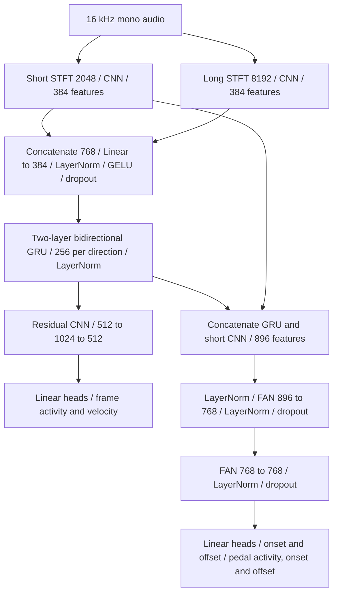

# Version 12 model reference

[README](../README.md) · [Training command table](../README.md#training-commands) · [V11 sustain reference](model-v11.md#sustain-targets-and-playback) · [V11.1 FFT reference](model-v111.md)

V12 is **`onsets-dual-stft-split-fan-sustain`**, available through its explicit architecture flag, with **9,991,654 trainable parameters** at its default dimensions. Model version is **`12`** and checkpoint format version is **`15`**. Fresh automatic training now selects V12.1. V11.1 and earlier architectures retain their explicit training commands and checkpoint compatibility.

## Structure

The GRU's normalized 512 features feed both output paths. The frame path uses one residual temporal CNN block with convolutions **512 → 1024 → 512**, kernel size 3, padding 1, eight-group GroupNorm, GELU and dropout 0.2. The residual adds its input directly. Frame activity and velocity read this path.

The event path concatenates the same GRU features with the **direct short-CNN output**, giving 896 features per frame. After input LayerNorm, two existing Fourier Analysis Network (FAN) layers transform **896 → 768 → 768**, with LayerNorm and dropout after each layer. FAN combines learned cosine, sine and nonperiodic features. Here it processes learned per-frame features; it does not extract raw audio windows or replace either STFT.

The event path predicts note onset, note offset, pedal activity, pedal onset and pedal offset. There is no separate pedal GRU and no probability-conditioned frame or offset refinement in V12. Each head reads its assigned branch; the existing event decoder constructs notes from frame, onset and offset probabilities.

Four note heads each output **88 logits per frame**. Three pedal heads each output **one logit per frame**. The shared inference interface and all three overlap methods therefore retain the same seven-output shapes as V11/V11.1.

## Spectral context and alignment

| Branch | Hann window | Frequency bins | Bin spacing | Positions after CNN pooling |
| --- | --- | ---: | ---: | ---: |
| Short STFT | 2048 samples / **128 ms** | 1025 | 7.8125 Hz | 17 |
| Long STFT | 8192 samples / **512 ms** | 4097 | 1.953125 Hz | 65 |

V12 reuses V11.1's independent full-spectrum STFT/CNN branches. Centered periodic Hann windows use constant zero padding and a **320-sample / 20 ms hop**. Both branches produce `floor(samples / 320) + 1` aligned frames, so four seconds produces **201 frames in every output head**. STFT calculations stay in float32 under autocast.

Magnitudes are divided by each fixed Hann-window sum (`n_fft / 2`), then transformed with `log1p(10 * magnitude)`. The model preserves waveform amplitude and applies no measured-loudness normalization to individual audio windows. Both CNNs retain the complete linear frequency spectrum, with channels **16, 32, 64, 96**, 3×3 convolutions, eight-group GroupNorm, GELU and frequency-only pooling factors **2, 2, 2, 8**. Ceiling pooling preserves the highest bins. Each encoder projects to 384 features per frame.

Four-second training windows remain the default. Centered FFTs and bidirectional recurrence use earlier and later sound within the available section, so V12 remains an offline transcription model.

## Parameter budget and options

| Component | Trainable parameters |
| --- | ---: |
| Short FFT CNN | 706,944 |
| Long FFT CNN | 2,476,416 |
| Fusion projection and normalization | 296,064 |
| Two-layer BiGRU and output normalization | 2,169,856 |
| Frame residual CNN | 3,150,336 |
| Frame and velocity heads | 90,288 |
| Two FAN layers and normalization | 964,096 |
| Onset, offset and three pedal heads | 137,651 |
| Three learned global thresholds | 3 |
| **Total** | **9,991,654** |

STFTs and Hann windows add no trainable parameters. Defaults are feature width **384**, GRU hidden size **256 per direction**, **two** GRU layers, **one** residual CNN block, event width **768**, **two** event FAN layers, dropout **0.2** and release persistence **three frames**.

| Option | V12 default | Use |
| --- | ---: | --- |
| `--short-fft` | 2048 | Short STFT window size. |
| `--long-fft` | 8192 | Long STFT window size. |
| `--feature-width` | 384 | Features produced by each CNN and the fusion projection. |
| `--hidden-size` | 256 | Hidden units per GRU direction. |
| `--gru-layers` | 2 | Bidirectional recurrent depth. |
| `--residual-blocks` | 1 | Residual CNN blocks in the frame/velocity path. |
| `--event-width` | 768 | Output width of each event FAN layer. |
| `--event-fan-layers` | 2 | FAN depth in the onset/offset/pedal path. |

All dimensions are saved in model configuration; changing them changes the parameter budget. Existing `--rnn-backend` and `--release-frames` controls remain available. `--fan-window` is a V11 raw-audio option and is rejected for V12. V8.1's temporal Fourier-mode/layer options do not control V12's event FANs.

## Sustain, optimization and compatibility

V12 keeps V11's **`note_duration="sustain_extended"`** targets. A key released under sustain remains active until pedal release, capped by the next strike of the same pitch. Extension is computed on the complete performance before selecting training or validation windows. Frame and offset targets, validation references and decoded result durations therefore use the same interpretation. Pedal activity, pedal-down and pedal-up receive their existing separate supervision. Already-extended result durations are used directly during playback so predicted pedal intervals do not extend notes twice.

The existing supervised frame, onset, offset, release, velocity and pedal losses remain in use; the three pedal losses share the reported pedal component. Logging retains weighted components and matching unweighted training/validation frame BCE. All 88 pitches have equal default weights, with ordinary random training windows and deterministic validation windows.

Three gradient-trained global thresholds use the per-pitch mean of **F1, F2, F3, F4 and F5**, including unsupported-pitch false-activity penalties and threshold-prior regularization. **Minimum validation AvgF loss** selects the best checkpoint and controls learning-rate scheduling. Decoded note and pitch scores remain diagnostics; lower smooth loss does not establish improved note-duration accuracy.

The documented start command sets recognizer LR **0.0003** and threshold LR **0.003**. Fresh V12 halves both parameter-group rates after **15 consecutive non-improving epochs**, down to `1e-6`, using the same absolute `1e-6` improvement tolerance as best-checkpoint saving. A qualifying improvement resets the counter. Resume without a patience override restores the saved scheduler; an explicit `--lr-patience` applies after restoration and retains the accumulated counter. Early stopping is disabled.

Fresh V12 starts with random recognizer weights and three random global thresholds. Files are **`piano-v12.pt`**, **`piano-v12.last.pt`** and **`piano-v12.history.jsonl`**. Initialize only from a compatible V12 checkpoint; earlier architectures have different recurrent and output paths. Resume restores the saved architecture, optimizer, scheduler, epoch and random state, so resuming V11.1 continues V11.1. See the [README command table](../README.md#training-commands) for separate start/resume commands for every version.

The desktop app discovers V12 checkpoints and prefers `piano-v12.pt` when available. Existing weighted averaging, 50/50 averaging, center stitching, staff display, ByteDance comparison and piano playback apply. Native inference and evaluation preserve V12's sustain and F1–F5 metadata. The browser-only Site/exporter retains its existing V8.1/V9 architecture limits.

## Verification boundaries

Verified on **2026-10-16**: **80 checks passed**, including the exact parameter budget, gradients throughout both encoders and GRU directions, direct short-CNN event connection, short/odd/four-second alignment, sustain and repeated strikes, checkpoint roundtrips, training resume, AvgF selection, loss reporting, 15-epoch LR timing and overlap/app compatibility. A small training smoke test and default-size CPU forward/backward/AdamW step passed. Two CUDA checks were skipped because the GPU was in use. See the [verification report](../diagnostics/v12-verification.json).

Checkpoint saves retain atomic replacement and make at most five attempts when Windows briefly locks a file, with at most 0.75 seconds of retry delays. Persistent failures propagate and leave the previous checkpoint intact.

Full training and recognition-quality comparison follow separately. Reducing the recurrent depth or adding FAN event processing does not itself establish faster training or higher accuracy. Compare trained models on the same complete recordings using the same sustained-duration references.
