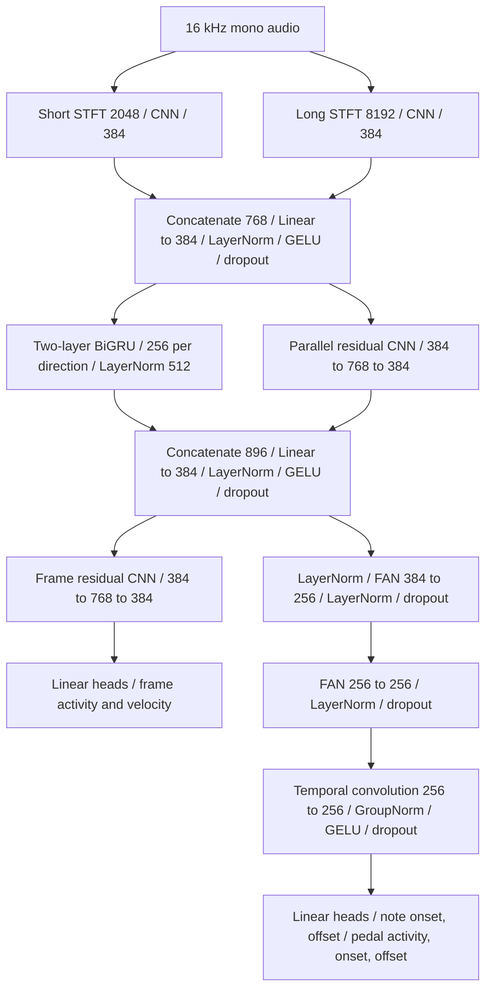

# Version 12.1 model reference

[README](../README.md) · [Training command table](../README.md#training-commands) · [V12 reference](model-v12.md)

V12.1 is `onsets-dual-stft-parallel-fan-sustain`, the default for fresh automatic training. It has **9,976,422 trainable parameters**, **0.15% fewer than V12**. Model version is **12.1**; checkpoint format is **16**.

## Structure

The two FFT/CNN outputs are concatenated and projected to 384 features. The normalized GRU output and independent parallel residual CNN output are concatenated, then projected from 896 to 384 features. Both output paths read this joint representation. This implements the drawing's parallel recurrent/convolutional stage using concatenation.

The parallel residual CNN and later frame residual CNN use independent weights. Each existing residual block has temporal convolutions `width → 2×width → width`, kernel size 3, padding 1, eight-group GroupNorm, GELU and dropout. The event CNN is a single temporal convolution with kernel size 3, padding 1, eight-group GroupNorm, GELU and dropout. It follows the two FAN layers. Dropout defaults to 0.2.

FAN layers combine learned cosine, sine and nonperiodic features of each frame. Their temporal context comes from the shared GRU and convolutional paths. The note heads output 88 logits per frame; the three pedal heads each output one. Frame and velocity read the frame branch, while onset, offset and pedal read the event CNN. Note decoding combines frame and event predictions.

## FFT preprocessing and alignment

Both branches retain the full V12/V11.1 magnitude spectrum and independent compact CNNs: channels 16, 32, 64, 96; frequency-only pooling factors 2, 2, 2, 8; GroupNorm, GELU and ceiling pooling. Each projects to 384 features per frame.

| Branch | Window | Frequency bins | Frequency spacing |
| --- | --- | ---: | ---: |
| Short STFT | 2048 samples / 128 ms | 1025 | 7.8125 Hz |
| Long STFT | 8192 samples / 512 ms | 4097 | 1.953125 Hz |

Centered periodic Hann windows use constant zero padding and the existing 320-sample / 20 ms hop. Magnitudes are divided by the fixed Hann-window sum (`n_fft/2`) and passed through `log1p(10*magnitude)`. FFT calculations stay in float32 under autocast. Input waveform loudness is preserved without per-window amplitude normalization.

All heads produce `floor(samples/320)+1` frames: four seconds gives **201 frames**. Centered FFTs and bidirectional recurrence use future sound within the available section, so the model remains suitable for offline transcription.

## Parameter budget and options

| Component | Trainable parameters |
| --- | ---: |
| Short FFT CNN | 706,944 |
| Long FFT CNN | 2,476,416 |
| Acoustic fusion and normalization | 296,064 |
| Two-layer BiGRU and output normalization | 2,169,856 |
| Parallel residual CNN | 1,772,928 |
| Joint projection and normalization | 345,216 |
| Frame residual CNN | 1,772,928 |
| Frame and velocity heads | 67,760 |
| Two event FAN layers and normalizations | 124,928 |
| Event temporal CNN | 197,376 |
| Onset, offset and three pedal heads | 46,003 |
| Learned global thresholds | 3 |
| **Total** | **9,976,422** |

Defaults: feature width 384, GRU hidden size 256 per direction, two GRU layers, one frame residual block, event width 256 and two FAN layers. One parallel residual CNN and one post-FAN CNN are fixed parts of V12.1's structure. `--residual-blocks` controls the frame branch only.

Existing FFT, feature-width, hidden-size, GRU-layer, event-width, event-FAN-layer, backend and release-persistence options apply; all configurable dimensions are saved. Feature and event widths must be at least 16 and divisible by eight. The event minimum keeps GroupNorm valid for one-frame, single-item inputs. `--fan-window` remains specific to V11's raw-audio FAN and is rejected for V12.1.

## Sustain, training and compatibility

V12.1 uses V11's `sustain_extended` duration targets and three supervised pedal outputs. Notes released under a pedal hold extend to pedal-up, capped by the next same-pitch onset. Extension happens on the complete performance before window selection. Validation and playback use the same semantics; already extended note durations are not extended twice.

The existing frame, onset, offset, release, velocity and pedal losses remain in use. Logs report weighted components and comparable unweighted frame BCE. Three global thresholds are learned by gradient descent with equal pitch weights and the mean of F1–F5. Minimum validation AvgF loss selects the best checkpoint; decoded note scores remain diagnostics.

Fresh training uses recognizer LR 0.0003 and threshold LR 0.003. Fifteen consecutive non-improving epochs halve both rates, with absolute improvement tolerance `1e-6` and minimum LR `1e-6`. Resume preserves saved policy unless explicitly overridden. Early stopping stays disabled. The default training context remains four seconds.

Start with random weights or a compatible V12.1 initialization. V12-to-V12.1 initialization is rejected because the processing paths differ. Resuming older checkpoints keeps their saved architecture, including V12. V12.1 writes `piano-v12.1.pt`, `piano-v12.1.last.pt` and `piano-v12.1.history.jsonl`.

The desktop app prefers the V12.1 best checkpoint when available and retains all earlier models. Native inference, evaluation, three overlap methods, sustain decoding and piano playback support its seven outputs. The browser-only Site exporter retains its existing architecture limits.

## Verification and added data

On **2026-10-17**, **80 automated checks passed** and two optional CUDA checks were skipped. The default four-second CPU forward/backward/AdamW check verified finite nonzero gradients for every parameter; ablation checks confirm that both parallel paths affect both output branches. Additional checks cover exact parameter budget, short/odd inputs, FFT scaling, state roundtrips, legacy budgets, sustained targets, loss components, evaluation, minimum AvgF selection, exact LR patience, overlap and app selection. See the [verification report](../diagnostics/v121-verification.json).

The same update added **1,997,539,801 bytes / 35 official MAESTRO training pairs**, or **3.092 hours**. All 70 files passed size/CRC32 checks and all 35 pairs loaded with sustain targets. Active training is now **95 recordings / 7.467 hours**. At 32 four-second windows per recording and batch size four, an epoch contains **760 batches**. Restart/resume training and omit `--max-files` to load all active recordings. Validation and test sets remain unchanged. [Data verification](../diagnostics/training-data-addition-v121-2026-10-17.json).

Full training and recognition-quality comparisons follow separately. Matching parameter count does not establish matching runtime, convergence or accuracy. The added training data increases the number of batches per epoch at the same windows-per-file setting.
